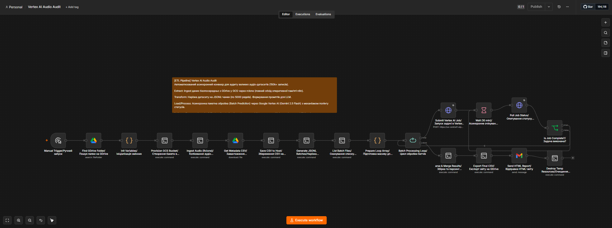
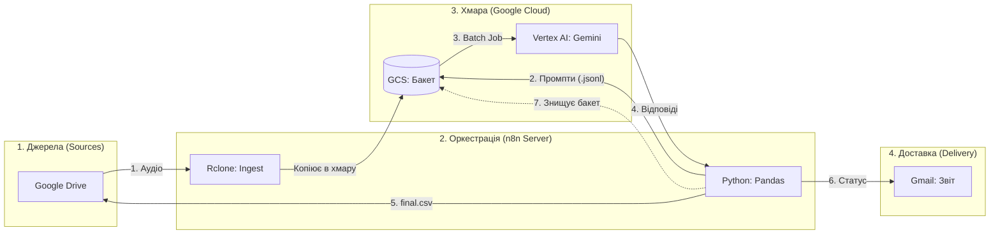

> **Archived.** This is the first version of the pipeline. The current, rewritten project (blind two-step transcription, Vertex AI Batch without SSH, tests) lives in **[ai-audio-qa-pipeline-evolution](https://github.com/IlyaRumasov/ai-audio-qa-pipeline-evolution)**.

# 🎧 Vertex AI Audio Audit (ETL Pipeline)

## 📋 Про проєкт

Цей ETL-пайплайн розроблено для обробки гігантських обсягів аудіоданих без перевантаження оперативної пам'яті сервера n8n. Завдяки використанню Batch Prediction API та прямої маршрутизації файлів між Google Drive та Google Cloud Storage, конвеєр здатен стабільно транскрибувати та перевіряти тисячі аудіофайлів автоматично.

## 🗺️ Загальна схема воркфлоу

### 📊 Архітектурна схема руху даних (Data Flow)

## 🚀 Архітектура та етапи роботи (Zero-waste)

Вся логіка (включно зі скриптами обробки) інкапсульована всередині воркфлоу n8n та виконується через SSH на цільовому сервері:

1. **Extract (Ingest):** Пряме копіювання даних із Google Drive у тимчасовий GCS-бакет за допомогою `rclone` (повний обхід RAM n8n).
2. **Transform:** Inline Python-скрипти (Pandas) всередині SSH-нод нарізають масив даних на JSONL-чанки (по 5000 рядків) та формують промпти для LLM.
3. **Load / Process:** Асинхронна пакетна обробка через Vertex AI Batch Prediction із циклічним полінгом (опитуванням) статусів виконання.
4. **Delivery:** Парсинг відповідей Gemini, збірка фінального звіту `final_ready.csv`, експорт назад на GDrive та відправка сповіщення на Gmail.
5. **Cleanup:** Ідемпотентність запусків — динамічні GCS-бакети та локальні тимчасові файли автоматично знищуються після завершення циклу.

## 🛠 Стек технологій

* **Оркестрація:** n8n 
* **Логіка нод:** Bash, Python 3 (Pandas, JSON, Regex)
* **Хмарна інфраструктура:** Google Cloud Storage (GCS), Google Vertex AI (Gemini 2.5 Flash)
* **CLI Утиліти:** rclone, gsutil

## ⚠️ Системні вимоги (Prerequisites)

Оскільки n8n делегує обробку даних через SSH-ноди, на цільовому Linux-сервері **обов'язково** мають бути встановлені:

1. **Python 3** та бібліотека `pandas` (`pip install pandas`).
2. **Google Cloud CLI** (`gcloud`, `gsutil`).
3. **Rclone**.

### Структура директорій на сервері
Воркфлоу очікує наявність наступних системних файлів на сервері:
* `/opt/n8n_data/gcp-key.json` — Service Account ключ для доступу до Google Cloud.
* `/opt/n8n_data/rclone/rclone.conf` — конфігурація rclone для доступу до GDrive.

## ⚙️ Розгортання (Deployment)

1. **Імпорт в n8n:** Завантажте файл `[ETL Pipeline] Vertex AI Audio Audit.json` у ваш інстанс n8n.
2. **Налаштування Credentials:** * Додайте доступи для `Google Drive OAuth2`, `Google Cloud Service Account` та `Gmail OAuth2`.
   * Налаштуйте доступ у нодах `SSH` до вашого сервера.
3. **Запуск:** Вкажіть ID необхідної папки у ноді `Find GDrive Folder` та запустіть воркфлоу кнопкою *Test Workflow* (Manual Trigger).